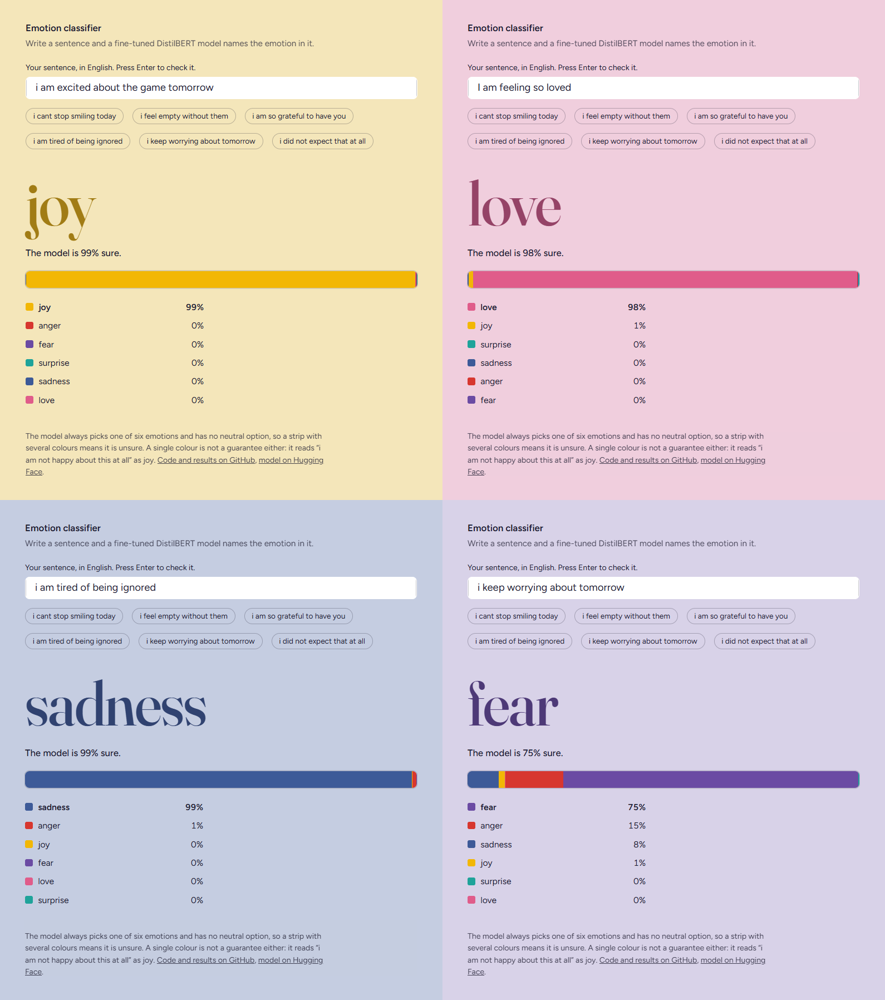
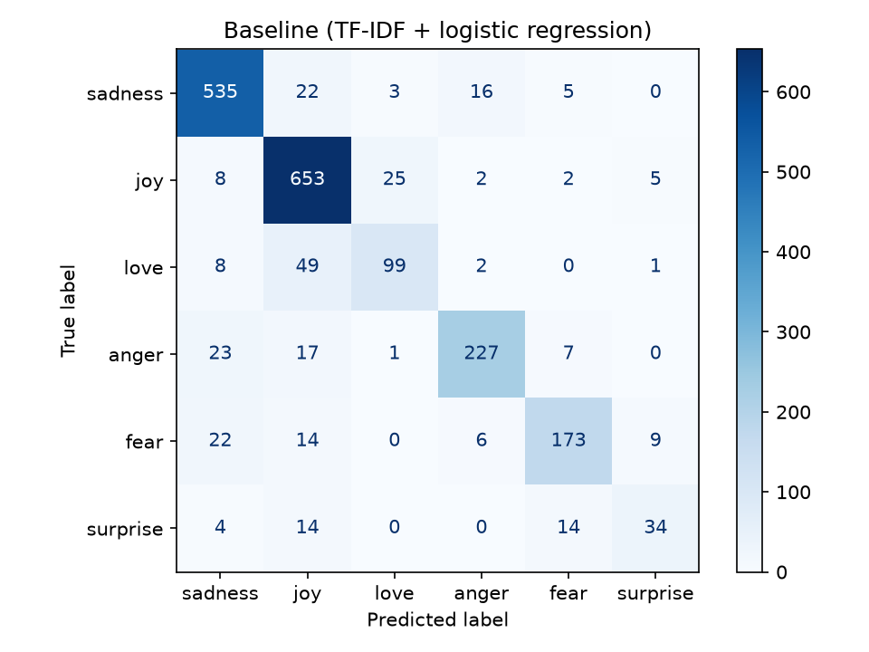
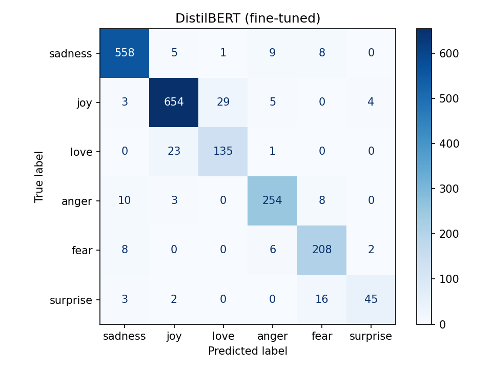

# Emotion classifier

Reads a short English sentence and names the emotion in it: sadness, joy, love, anger, fear, or surprise.

The project compares two approaches on the same data: a simple word-counting baseline and a
fine-tuned DistilBERT model.

- **Live demo:** https://emotion-classifier-qjr9unrcl7oae8bpzhtyj8.streamlit.app/
- **Model:** https://huggingface.co/saaddevasrih/emotion-distilbert



In the demo, the page takes on the colour of the emotion the model finds, and the colour is stronger
when the model is surer. One strip shows how the 100% is shared between the six emotions, so a strip
with several colours means the model is unsure.

## Results

Measured once on the test set (2,000 sentences that neither model saw during training).

| Model | Accuracy | Macro-F1 | Wrong out of 2,000 |
|---|---|---|---|
| TF-IDF + logistic regression (baseline) | 0.861 | 0.792 | 278 |
| DistilBERT, fine-tuned | **0.927** | **0.888** | 146 |

F1 score per emotion:

| Emotion | Test sentences | Baseline | DistilBERT | Gain |
|---|---|---|---|---|
| sadness | 581 | 0.906 | 0.960 | +0.054 |
| joy | 695 | 0.892 | 0.946 | +0.054 |
| anger | 275 | 0.860 | 0.924 | +0.064 |
| fear | 224 | 0.814 | 0.897 | +0.083 |
| love | 159 | 0.690 | 0.833 | +0.143 |
| surprise | 66 | 0.591 | 0.769 | +0.178 |

The biggest gains are on the two rarest emotions. That is why macro-F1, which counts every emotion
equally, improved more than accuracy.

| Baseline | DistilBERT |
|---|---|
|  |  |

## What the errors show

**The baseline counts words and ignores context.** Typical mistakes:

- "i just feel extremely comfortable with the group of people that i dont even need to hide myself"
  was predicted as anger, because "dont", "need" and "hide" look negative one by one.
- A sentence about losing a father was predicted as joy, because "sweet", "nostalgia" and "luck"
  outvoted "loss".

DistilBERT reads each word in the context of the others and gets both of these right.

**What DistilBERT still gets wrong:**

- Joy and love are mixed up in both directions (52 of the 146 remaining errors).
- 16 of the 66 surprise sentences are predicted as fear. Surprise makes up less than 4% of the training data.

**Limits of the data:**

- Some labels are debatable, so no model can reach 100% here.
- There is no neutral class. The model always picks one of the six emotions, even for a sentence
  without any emotion. "the train leaves at five" comes out as fear with only 34%. The demo therefore
  shows the share of all six emotions.
- Simple negation can fool it. "i am not happy about this at all" is classified as joy with 99%
  confidence. Only 2 of the 16,000 training sentences contain "not happy" (`check_negation.py`),
  so the model never learned that pattern. A high percentage does not guarantee a correct answer.
- The texts are short, lowercase and in English. Other styles and languages will work worse.

## How it works

| File | What it does |
|---|---|
| `explore.py` | Prints the size of the splits, how often each emotion appears, and example sentences |
| `baseline.py` | Turns text into TF-IDF word counts, trains a logistic regression, and evaluates it |
| `train_distilbert.ipynb` | Fine-tunes `distilbert-base-uncased` for 3 epochs on Google Colab (T4 GPU) and evaluates it |
| `check_negation.py` | Counts the training sentences that contain "not happy" and shows their labels |
| `demo/app.py` | Streamlit app that loads the model from the Hugging Face Hub |

The dataset is already split into 16,000 training, 2,000 validation and 2,000 test sentences.
The validation set was used to pick the best epoch. The test set was only used for the final numbers.

Training settings for DistilBERT: 3 epochs, batch size 32, learning rate 2e-5, weight decay 0.01,
best epoch chosen by validation macro-F1.

## Run it yourself

Baseline, on any PC:

```bash
python -m venv .venv
.venv\Scripts\activate        # Windows  (macOS/Linux: source .venv/bin/activate)
pip install -r requirements.txt

python explore.py
python baseline.py
```

Fine-tuning: open `train_distilbert.ipynb` in Google Colab, choose a T4 GPU runtime, and run the cells from top to bottom.

Demo, locally:

```bash
pip install streamlit -r demo/requirements.txt
streamlit run demo/app.py
```

## Data

[dair-ai/emotion](https://huggingface.co/datasets/dair-ai/emotion) on Hugging Face.
The dataset is provided for educational and research purposes.

## Ideas for later

- Add negated example sentences to the training data and retrain
- Give the rare emotions more weight during training, to improve surprise
- Try a larger model and compare the gain with the extra cost
- Add a neutral class from another dataset
